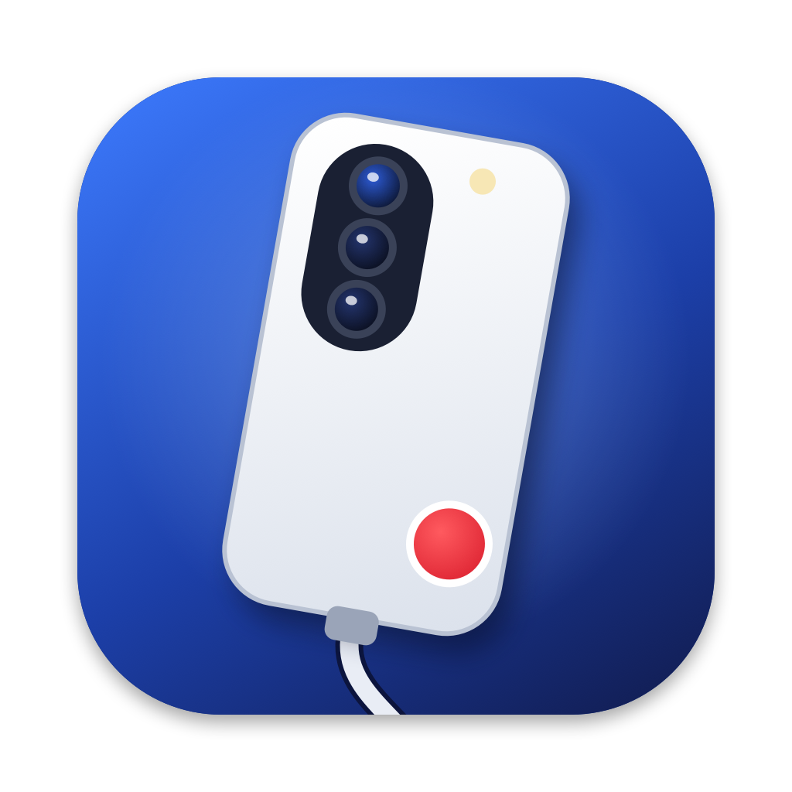

<p align="center"></p>

# PhoneCam

Use your Android phone as a plug-and-play USB webcam — and microphone — on your Mac.

Plug the phone in and a camera called **PhoneCam** and a microphone called **PhoneCam Microphone**
show up in Teams, Zoom, FaceTime, Meet, OBS, Photo Booth: anything that uses a camera or mic.
No OBS, no window to keep open, no app on the phone.

- **Menu bar app** with a live preview of what others see
- **USB only**: low latency, no Wi-Fi drops, hardware H.264 decoding
- **Back or front camera**, 720p or 1080p at 30 fps
- **The phone's microphone** as a Mac input (raw 48 kHz stereo over USB, ~30 ms buffer)
- **Rotate in 90° steps**, so the phone can sit however you like; fill the frame or fit with bars
- **Runs the phone camera only when needed** (or always — your choice): it starts when an app opens
  PhoneCam and stops a few seconds after the last one closes
- **Reconnects by itself** when you replug the phone or something else borrows its camera
- **Keeps the phone awake** while streaming (phones release the camera when the screen sleeps)

## Get started

You need a Mac with **macOS 14 or later** and an Android phone with **Android 12 or later**
(Android 11+ for the microphone), plus a USB cable that carries data.

### 1. Install PhoneCam

With [Homebrew](https://brew.sh) — this also installs `adb`, which PhoneCam uses to talk to the phone:

```sh
brew install --cask tensarflow/tap/phonecam
```

Or download **PhoneCam-x.y.z.dmg** from the [latest release](https://github.com/tensarflow/PhoneCam/releases/latest),
open it and drag PhoneCam to Applications. Then install `adb`, either with
`brew install android-platform-tools` or by unzipping Google's
[SDK Platform-Tools](https://developer.android.com/tools/releases/platform-tools) into your home
folder or Downloads (PhoneCam looks for `platform-tools/adb` there).

### 2. Allow the camera

Open PhoneCam (it lives in the menu bar). macOS asks once to allow its camera:
**System Settings → General → Login Items & Extensions → Camera Extensions → turn on PhoneCam**.

### 3. Set up the phone

1. On the phone, open **Settings → About phone** (on Samsung: **About phone → Software information**)
   and tap **Build number** seven times until it says you're a developer.
2. Open **Settings → Developer options** (on Samsung it's at the bottom of Settings) and turn on
   **USB debugging**.
3. Plug the phone into the Mac and tap **Allow** on the "Allow USB debugging?" prompt. Tick
   *Always allow from this computer* so it doesn't ask again.

### 4. Use it

In your video app, choose **PhoneCam** as the camera. The phone's camera starts within a few
seconds. For the microphone, open the PhoneCam panel, click **Install…** next to *Use the phone's
microphone* (macOS asks for your password, and Mac audio pauses for a moment), then choose
**PhoneCam Microphone** in your video app.

Turn on **Open PhoneCam at login** in the panel and the camera is ready whenever you plug the phone in.

### Microphone over Bluetooth (optional)

No cable and no shared Wi-Fi needed, handy on guest networks. Install the **PhoneCam Mic** Android app
([Android/](Android/README.md)), turn on **Also over Bluetooth** under the microphone setting in the panel,
then tap **Turn mic on** in the app. While it's connected, it is what **PhoneCam Microphone** plays. Its
**TALK** button presses Right Option on the Mac (FluidVoice's dictation shortcut), which needs PhoneCam
allowed under Privacy & Security → Accessibility.

## The panel

Click the menu bar icon:

| | |
|---|---|
| Switch | Turns PhoneCam on or off |
| Preview | What video apps receive; ↺ ↻ rotate it |
| Phone camera | **When used**: the phone's camera runs only while an app uses PhoneCam (or the panel is open), starting in about 2–3 s. **Always on**: it runs whenever the phone is plugged in, so the picture is instant |
| Camera | Back or front |
| Rotation | 0°, 90°, 180°, 270° (90°/270° capture 4:3 so the crop keeps detail) |
| Framing | **Fill** crops to fill 16:9, **Fit** shows everything with bars |
| Quality | 720p or 1080p |

## Troubleshooting

- **"Reconnecting… camera is busy"** — face unlock or the phone's camera app took the camera.
  Leave the phone locked and untouched while streaming; PhoneCam takes the camera back on its own.
- **Stuck on "Waiting for the phone"** — unlock the phone and accept the USB debugging prompt.
- **"No phone connected" although it's plugged in** — check USB debugging is on, try another cable
  (charge-only cables don't work), and run `adb devices` in Terminal to see whether the Mac sees it.
- **Your video app shows no PhoneCam camera** — check PhoneCam is turned on under Camera Extensions,
  then restart the video app (most apps only look for cameras at launch).
- **Your own preview shows mirrored text** — that's your video app mirroring your self-view;
  everyone else sees it the right way round.
- **macOS switched the Mac's default input to PhoneCam Microphone** — macOS tends to select newly
  added inputs. Pick your usual one again in System Settings → Sound → Input.
- Logs: `~/Library/Logs/PhoneCam.log` (app) and
  `log show --predicate 'subsystem ENDSWITH "PhoneCam.CameraExtension"' --last 10m` (camera).

### Uninstall

`brew uninstall --zap --cask phonecam` removes the app, its settings and the microphone driver. Without Homebrew, delete
PhoneCam from Applications (macOS removes its camera) and run
`sudo rm -rf /Library/Audio/Plug-Ins/HAL/PhoneCamMic.driver && sudo killall coreaudiod`.

## How it works

```
Android phone                         Mac
┌──────────────────┐   USB / adb   ┌────────────────────────────┐      ┌───────────────────────┐
│ scrcpy server     │ ───H.264────▶ │ PhoneCam.app (menu bar)    │      │ PhoneCam Camera       │
│ (camera + mic,    │ ───PCM──────▶ │ VideoToolbox decode,       │ ───▶ │ (Core Media IO        │ ──▶ Teams, Zoom…
│  pushed over adb) │               │ rotate/scale on the GPU    │ sink │  camera extension)    │
└──────────────────┘               └─────────────┬──────────────┘      └───────────────────────┘
                                                  │ PCM   ┌──────────────────────────────┐
                                                  └─────▶ │ PhoneCam Microphone          │ ──▶ Teams, Zoom…
                                                          │ (Core Audio driver)          │
                                                          └──────────────────────────────┘
```

- The app polls `adb` for a phone, pushes the bundled [scrcpy](https://github.com/Genymobile/scrcpy)
  server and starts it with `video_source=camera` (and `audio_source=mic`). Nothing is installed on the phone.
- The H.264 stream is decoded with VideoToolbox, rotated and fitted to 1920×1080 with Core Image,
  and written into the camera extension's **sink stream**. The extension forwards it to its
  **source stream**, which is what video apps see; with no picture it shows what's going on.
- The extension tells the app how many apps are watching, so the phone only runs when needed.
- The mic arrives as raw PCM. PhoneCam plays it into a hidden output device of the bundled
  Core Audio driver (`Driver/PhoneCamMic.c`), which loops it straight into its visible input device.

## Build from source

Needs Xcode, [XcodeGen](https://github.com/yonaskolb/XcodeGen) (`brew install xcodegen`) and a
**paid Apple Developer team** — macOS only loads camera extensions signed with a provisioning
profile that allows system extensions.

1. Set your team and a bundle ID prefix you own:

   ```sh
   cat > Config/Signing.local.xcconfig <<'EOF'
   DEVELOPMENT_TEAM = ABCDE12345
   BUNDLE_ID_PREFIX = com.yourname
   EOF
   ```

2. Generate the project and build (Xcode must be signed in to that team):

   ```sh
   xcodegen generate
   xcodebuild -project PhoneCam.xcodeproj -scheme PhoneCam -configuration Release \
     -derivedDataPath build -allowProvisioningUpdates -allowProvisioningDeviceRegistration build
   ```

3. Install to **/Applications** (system extensions only load from there) and open it:

   ```sh
   ditto build/Build/Products/Release/PhoneCam.app /Applications/PhoneCam.app
   open /Applications/PhoneCam.app
   ```

When you change the camera extension, bump `CURRENT_PROJECT_VERSION` in `project.yml` so macOS
replaces the installed one; when you change the microphone driver, bump its `CFBundleVersion` there
and PhoneCam offers an update.

### Releasing

`Scripts/release.sh 1.2.0 --publish` archives a universal build, signs it with Developer ID,
notarizes and staples it, packages `build/release/PhoneCam-1.2.0.dmg` and creates the GitHub release.
Store notarization credentials once with
`xcrun notarytool store-credentials PhoneCam-notary --apple-id YOU@example.com --team-id TEAMID`.
Then update `version` and `sha256` in the Homebrew cask
([tensarflow/homebrew-tap](https://github.com/tensarflow/homebrew-tap)).

## License

[Apache License 2.0](LICENSE). Bundles the scrcpy server (Apache 2.0, © Genymobile and
Romain Vimont) — see [NOTICE](NOTICE).
